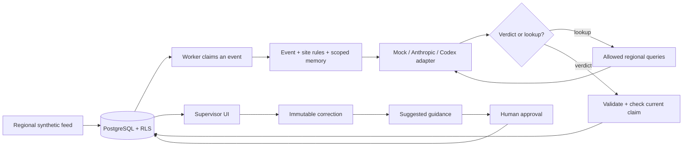

# Architecture

The application owns a small, explicit review loop. PostgreSQL coordinates work and keeps the audit trail. Models suggest verdicts and guidance; supervisors control corrections and reusable policy.

## Main choices

| Choice | Reason and trade-off |
| --- | --- |
| FastAPI, Pydantic, explicit SQL | Familiar request/DTO/service boundaries, with SQL visible for review. More manual mapping than an ORM, fewer hidden lifecycle rules. |
| PostgreSQL as queue and memory store | Transactions coordinate claims, feedback, and audit records. Enough for this prototype; an external queue adds another consistency boundary. |
| Fixed 15-minute claims, no heartbeat | Simple ownership and expiration. A crashed worker can delay work until expiry; healthy calls have a shorter 90-second budget. |
| Two workers per region | Demonstrates competition for work. Row locks coordinate them, not in-process locks. |
| Forced RLS plus explicit regional queries | RLS enforces regional isolation within a shared database, including when a query omits its region filter. |
| Baseline site rules supplied upfront | Ordinary alerts need one model call. Optional tools are reserved for additional context. |
| Three read-only lookups, four calls maximum | Bounded investigation with an inspectable trace. Complex cases can ask for supervision. |
| Corrections and approved guidance stored separately | One case correction is not automatically a lasting rule. Adds an approval step and makes trust visible. |
| Hard scope checks, then hybrid ranking | Similar wording cannot override trust or location boundaries. Measurements remain evidence; the model checks written conditions after retrieval. |
| Local embeddings, no vector database index | Small candidate sets fit in memory. Larger histories would need retrieval/index evaluation. |
| React state and periodic fetches | No router or global state framework. Three-second polling is sufficient here; SSE can wait. |

I chose these boundaries through design discussion and implementation review. The [AI disclosure](ai-assistance.md) describes the assistance used.

## Data and region boundary

Seven regional tables hold events, attempts, accepted reviews, corrections, guidance (including draft attempts), feed controls, and site context. Forced RLS requires each row's region to match a transaction-local setting. The application role cannot own the tables, be a superuser, or bypass RLS; connection setup checks this.

A signed session identifies the supervisor. FastAPI resolves that identity before the handler uses its region. Workers are constructed with one region. Neither model output nor an HTTP body chooses the query's region. Cross-region event IDs return 404, and scope filtering occurs before text reaches the embedding model.

The demo uses selectable regional identities and PostgreSQL trust authentication over a private Unix socket. A production deployment would use an identity provider and separate application and administrative credentials.

## Claims, expiry, retries, and stale workers

`ClaimStore.claim_next()` locks an eligible event using `FOR UPDATE SKIP LOCKED`, assigns a fresh attempt UUID, and records its deadline and provider. Model work happens after the transaction closes.

Every trace/result write locks the event and checks current attempt ID, worker ID, status, and expiration. Time is read **after** acquiring the lock. Otherwise a worker waiting on a lock could use an outdated timestamp to save after expiry.

Example: worker A owns attempt A until 10:15. It stalls. At 10:16 worker B claims attempt B. A eventually returns a plausible verdict, but its attempt no longer matches and the database rejects its save. B can save while its own claim is valid. A late response never overwrites B.

A failed or expired attempt consumes one of three automatic attempts. After three, the event stays failed until a supervisor explicitly retries; history is retained. Authentication/configuration errors do not silently switch providers. An uncertain database acknowledgement does not immediately release the claim and trigger another model call.

The database accepts one verdict per event. A crash before the save can repeat the provider call.

## Model boundary and investigation

The model interprets free-text rules; the harness enforces scope, approval, and claim ownership.

`Worker.investigate()` repeatedly:

1. Stores the exact application input.
2. Calls the selected adapter with the remaining time budget.
3. Records output, available usage, and timing.
4. Validates a verdict or executes a permitted lookup and adds its result to context.

The model can request `get_site_context` or `find_events`. Python validates parameters and executes fixed queries in the worker's region/site. The model cannot submit SQL, change region, approve guidance, or write records. Duplicate requests and invalid/bounded-out investigation lead to a clear failure or a supervisor question.

Limits are three lookups, four model calls, 64 KB context, 16 KB per tool result, and a default 90-second attempt budget. Anthropic requests have a default 1,200-token output limit. These bounds control review time, context size and model usage.

Verdicts have three states: `confirmed` with low/medium/high severity; `rejected` with no severity; or `needs_input` with a concrete question and no severity. A lookup response is a different validated branch of the same response schema. Excess guidance is escalated before a provider call. The model checks whether supplied rules actually conflict for this event.

Anthropic uses the official SDK directly with retries disabled. Codex invokes a pinned CLI as a practice adapter with its tools/configuration restricted; it has its own internal harness. Both return through the same application validation and persistence path. Mock supports the standing-severity demo sentences and asks for input on other approved wording.

## Memory and human authority

Saving a supervisor review appends a versioned correction and creates proposed guidance in one transaction. A background claim generates suggested wording. Drafts have their own bounded attempts and stale-worker checks. Editing the source correction supersedes its older guidance; a late draft cannot revive it.

Approval accepts wording only. A nonreusable draft opens an empty editor; both UI and API require at least 20 characters and four words. The supervisor checks the rule's conditions and approves its wording. Decision and severity are inherited from the immutable source correction, so approving a dismissed-alert rule cannot accidentally turn it into a high-severity confirmation. Changing that outcome requires changing the source event's supervisor review. Rejection and retirement remain explicit actions.

Selection first checks region, event type, site, zone, camera and approval status. Changes in distance, duration, counts, confidence or other metadata do not exclude a rule. Those facts remain in the current event and immutable source snapshot. The legacy database column `metadata_condition` is retained as source evidence for inspection; it no longer filters retrieval and is omitted from model guidance entries.

Case selection takes the latest correction per prior event, considers up to 64 recent cases and supplies the top three using equal-weight word overlap and embedding similarity. Approved guidance is ranked for presentation but all eligible entries are supplied, up to 16. A seventeenth rule triggers Needs input before any model call; the existing 64 KB context cap also applies. This avoids silently dropping a competing policy.

Applicable approved guidance takes precedence over the baseline where it explicitly changes that baseline. The source correction's decision/severity stays attached to that case; the rule's written ranges, dates and evidence requirements determine its use for a new event. Different outcomes may belong to disjoint conditions. Applicable contradictions, ambiguity or missing evidence require a supervisor question.

Rejected, retired and superseded guidance is excluded before ranking or encoding. A retired rule also excludes its exact source correction from future memory selection, after selecting the latest correction per event so an older version cannot reappear. Other corrections remain eligible; all records remain visible in history. Newly drafted wording must preserve supervisor-stated conditions without inventing exact-match requirements from incidental source measurements.

The local encoder is pinned `potion-base-8M`. Files are checksum-verified and loaded without network access at runtime; missing files fail startup. Embeddings are calculated on demand. They do not change model weights. Ranking diagnostics remain in the audit, while the model receives the smaller evidence payload.

Date phrases remain text for the real model to interpret. A November 12 exception can be retrieved for a November 14 event because its hard scope matches; the model must then reject its applicability and ask for missing authorization. Structured validity dates, scheduled expiry, broader policy predicates, and retrieval evaluation are future work. A review uses the memory snapshot selected at its start; retiring guidance does not rewrite that in-flight snapshot or historical reviews.

## Model selection

`REVIEW_MODEL_MODE=mock|anthropic|codex` sets one provider for new review and suggestion claims across all regions. `Settings.reviewer_for()` is shared by event claims, draft claims, and feed controls. Saved choices and `REVIEW_ENABLED_MODELS` cannot override a global mode. The UI shows the global provider; `/api/reviewer` rejects changes.

`REVIEW_MODEL_MODE=regional` explicitly enables the picker. Each region uses its saved choice or Mock, restricted to the configured providers. Global mode leaves these preferences stored so opting back into regional restores them. An attempt captures its provider before the call, and accepted results retain their provenance. Recreate both API and workers when changing environment mode; let active attempts finish first. A stream whose provider changed stops until explicitly restarted. No provider failure silently falls back to Mock.

## UI, stream, and operational boundaries

The UI displays the latest supervisor outcome separately from the original review. Safety events, dismissed alerts, needs input, pending work, and failures have separate filters. Filtering happens in SQL before the page limit. Counts and event-type choices describe the whole region.

Forms retain drafts while polling. Request UUIDs make correction/simulation retries idempotent; expected versions reject conflicting edits. Stream controls use version checks and read-back after lost responses. Each workspace binds API requests to its expected supervisor. The server compares that precondition with the signed session before regional reads or writes; the header never grants authority. Another tab changing session clears the old workspace, selection and drafts and returns it to the region chooser. Closed workspaces discard late responses. Only successful sign-in/out can set the session cookie, so delayed polling cannot reinstall an old account. Source events show current guidance status and link to its Suggested, Approved or History card. Empty review reasons disable Save; only an active save gets the busy cursor.

The synthetic source locks one feed row per region and commits insertion with cursor advancement. Starts have a five-minute default deadline, with ten-minute and until-paused options. A limit of 20 unresolved events prevents an unattended demo from growing without bound. Changing provider pauses arrivals but does not rewrite accepted reviews or in-flight provider choices.

The API health endpoint reports readiness. Feed timestamps, attempt deadlines, history, and token usage show progress. Further operational work would add worker monitoring, alerts and retention policies.

## Validation

- Changed distance, duration, counts, confidence, detector versions and absent metadata preserve guidance eligibility within the same scope. The model receives both current facts and original evidence. Location/type/region and approval boundaries remain hard filters.
- Up to 16 approved rules reach the provider even when source outcomes differ. Excess guidance requires consolidation. Rejected, retired and superseded guidance remains excluded; an in-flight review retains its saved snapshot.
- Dated guidance is retrieved on both November 12 and November 14 when other conditions match. Live Claude and Codex evaluations demonstrated dismissal inside the exception and Needs input outside it.
- Global mode is tested with conflicting persisted regional choices across reviews, suggestions, feeds and selector requests in all three regions. Anthropic/Codex routing tests use injected provider responses, not live credentials. The hosted preview uses explicit regional mode to retain its picker. Live-provider results are recorded separately in [verification](verification.md).
